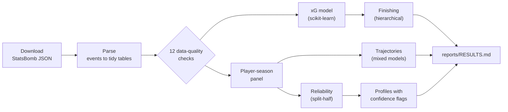
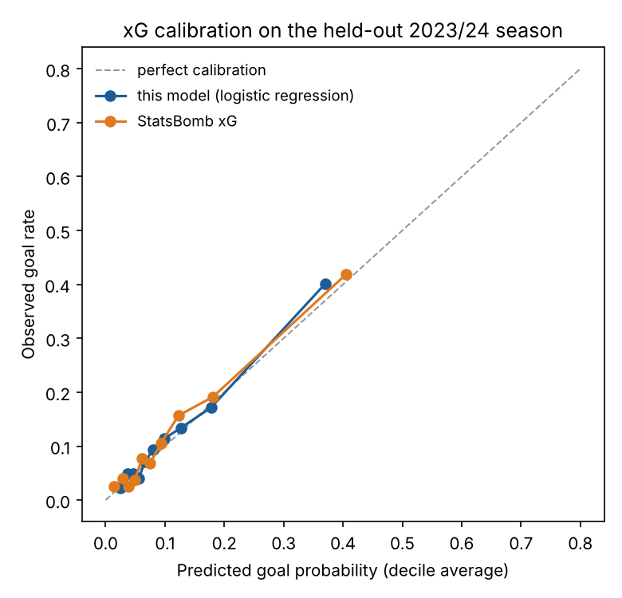
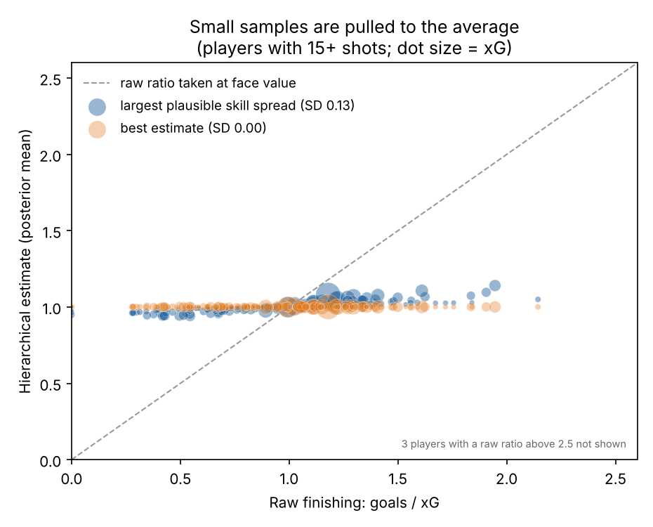
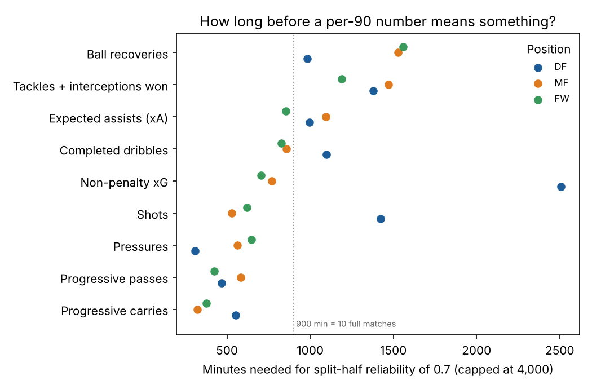
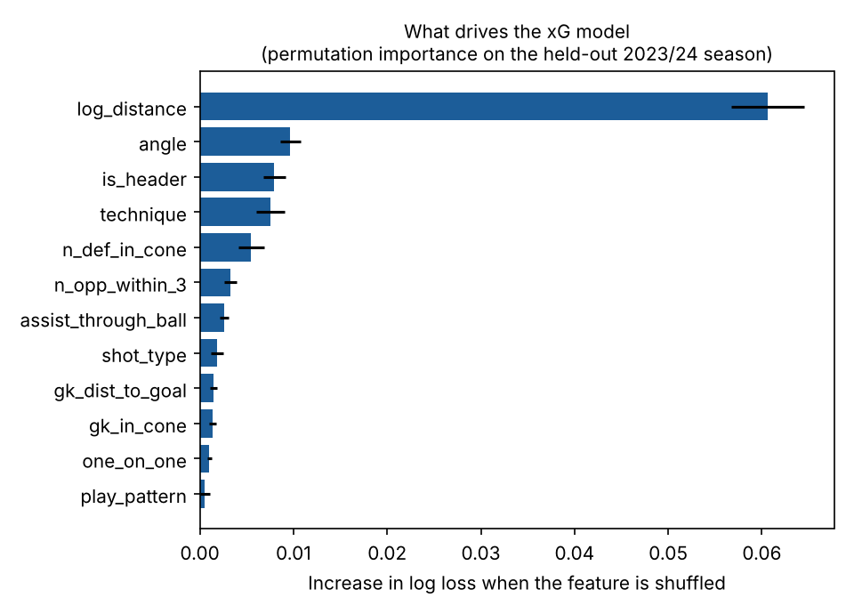
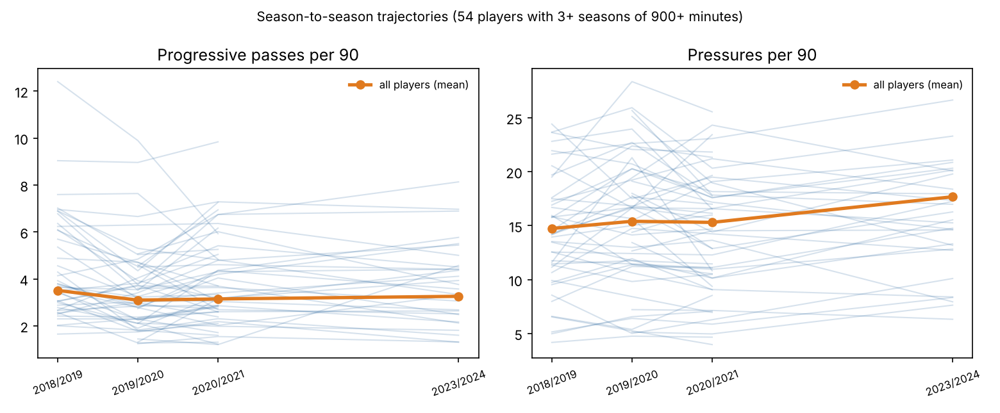
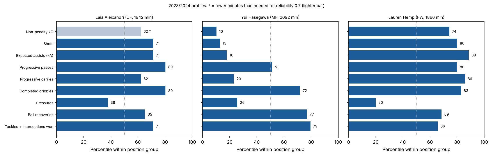

# Football Player Development Analytics

A reproducible Python pipeline on StatsBomb open data (FA Women's Super League, four seasons, 457 matches) that answers four questions a player-development analytics team asks every week:

1. **How good was the chance?** An expected-goals (xG) model, validated on a season it never saw.
2. **Is finishing a skill or noise?** A hierarchical model that shrinks small samples towards the league average.
3. **How do players change from season to season?** Longitudinal mixed-effects models with player-level intercepts and slopes.
4. **How many minutes before a per-90 number can be trusted?** Split-half reliability by position.

The results end in player profiles that show which numbers are reliable enough to discuss with a coach.

## Why this project

Development decisions rest on small samples. Young players get limited minutes, change quickly and are compared across very different amounts of evidence. In that setting, raw per-90 numbers and "goals minus xG" are easy to over-read. Each step here separates signal from noise and says how sure it is, with validation designed before the results were seen.

## Headline results

| Question | Method | Result |
| --- | --- | --- |
| Chance quality | Logistic regression vs gradient boosting (scikit-learn), 5-fold CV grouped by match, final test on the untouched 2023/24 season | On 2023/24: log loss **0.308** vs StatsBomb's own xG 0.300, ROC AUC 0.750 vs 0.775, calibration error 0.011 vs 0.014. Distance to goal dominates, then angle, headers, technique and defenders in the shooting lane. |
| Finishing | Gamma-Poisson hierarchical model, profile likelihood, next-season validation | No detectable spread in finishing beyond chance (best estimate SD ≈ 0; at most 0.13 at 95%). Raw goals/xG does not repeat between seasons (r = −0.04, n = 64). Assuming league-average finishing instead of raw goals/xG **cuts the error of next-season goal predictions by 13-46%** (mean absolute error). |
| Development | `rate ~ years + position + (1 + years \| player)`, REML, 487 player-seasons | 46-70% of the variation in a season's per-90 numbers is stable player differences (ICC). Players develop at **significantly different speeds** in progressive passing, progressive carrying and non-penalty xG (random slopes, p ≤ 0.001). Pressures rose about 3% a year across the league. |
| Reliability | Split-half (200 random splits) + Spearman-Brown, within position group | Pressures, progressive passes and progressive carries are reliable (0.7) after roughly **300-650 minutes**; ball recoveries and tackles + interceptions need roughly **1,000-1,550**; a defender's non-penalty xG needs about **2,500**. |

All tables and figures are in [reports/RESULTS.md](reports/RESULTS.md), generated from the CSV files in [reports/](reports/).

## How it works



1. **Data and quality.** Events and lineups are parsed into matches, shots and player-match tables. Twelve checks run on every build, for example: goals in the event data equal the final score in all 457 matches, team minutes equal eleven players times match length (lower only after red cards), and 99.2% of shots have a freeze frame. Minutes come from the event stream (starting XI, substitutions, red cards) because some lineup files have position spells with out-of-order times.
2. **xG.** 21 inputs per non-penalty shot: distance, angle, defenders inside the shooter-to-posts triangle, opponents within 3 yards, goalkeeper position, body part, technique, first time, under pressure, assist type and play pattern. Folds are grouped by match so shots from one game never sit in both training and test data. The better model on cross-validated log loss (logistic regression) was tested once on 2023/24.
3. **Finishing.** Goals ~ Poisson(θ × xG), with θ ~ Gamma(α, α/μ) across players. μ and α are estimated by maximum likelihood on the negative-binomial marginal, and each player's estimate is the posterior mean (α + goals) / (α/μ + xG). Because the likelihood is flat, the report also gives the largest skill spread the data cannot rule out (95% profile likelihood) and the estimates under it.
4. **Trajectories.** Per-90 metrics for outfield player-seasons with 900+ minutes, modelled with a random intercept and a random slope on years per player. The intraclass correlation says how much of a season's number belongs to the player; a likelihood-ratio test (with the boundary-corrected chi-square mixture) says whether players develop at different speeds.
5. **Reliability.** Each player-season's matches are split at random into halves 200 times; the correlation between halves, lifted with the Spearman-Brown formula, gives the minutes needed for a reliability of 0.7.
6. **Profiles.** Percentiles within position group, with any metric below its reliability threshold greyed out and starred.

## Results

| | |
| --- | --- |
|  |  |
|  |  |



Example profiles: the highest-minute defender, midfielder and forward of Manchester City WFC in 2023/24.



## Limitations

- This is senior women's league data, not academy data, and StatsBomb open data has no ages or growth measures. "Years" therefore mixes league-wide change with individual development, and 2021/22-2022/23 are missing.
- The xG model has no 360 tracking data; StatsBomb's own model ranks shots better (AUC 0.775 vs 0.750).
- The finishing prior is the same for every player. The highest-volume shooters mostly sit above 1.0 on raw goals/xG, which hints that a prior depending on position or shot volume might find skill this model cannot.
- The 900-minute threshold keeps regular starters only, and most players contribute two to four seasons, so slope estimates are noisy.
- Reliability depends on how different the players in this league are; treat the minutes as an order of magnitude.
- 2018/19 mixes StatsBomb data versions 1.0.3 and 1.1.0, so part of the drop in completed dribbles (about 9% a year) may come from definitions rather than football.

## Run it yourself

Python 3.11 or newer. The first run downloads about 1.3 GB from StatsBomb's GitHub repository.

```bash
git clone https://github.com/iramadhanil/football-player-development
cd football-player-development
python -m venv .venv
source .venv/bin/activate          # Windows: .venv\Scripts\activate
pip install -r requirements.txt
python -m player_development all   # download, build + quality checks, analyse
pytest -q                          # unit tests on synthetic data, no download needed
```

The steps can also run separately: `python -m player_development download`, `build`, then `analyse`. The analysis step takes one to two minutes.

The committed results were produced with Python 3.13, numpy 2.5.3, pandas 3.0.5, scipy 1.18.1, scikit-learn 1.9.1, statsmodels 0.15.0 and matplotlib 3.11.2. The tests also pass on Python 3.12 with the minimum versions in `requirements.txt`; older versions give the same conclusions, with small differences in the third decimal.

```text
player_development/
  config.py        seasons, paths, thresholds, metric list
  download.py      cached download of StatsBomb open data
  geometry.py      distance, angle, shooting cone, progressive actions
  parse.py         events -> matches, shots, player-match tables
  quality.py       data-quality checks
  xg.py            xG models, validation, calibration, importance
  finishing.py     Gamma-Poisson hierarchical finishing model
  panel.py         player-season per-90 panel
  trajectories.py  longitudinal mixed-effects models
  reliability.py   split-half reliability and minutes needed
  profiles.py      percentile profiles with confidence flags
  report.py        writes reports/RESULTS.md
tests/             pytest on synthetic StatsBomb-shaped data
reports/           committed results: CSV tables and figures
```

## Data and licence


Data: [StatsBomb open data](https://github.com/statsbomb/open-data). Under the StatsBomb Public Data User Agreement the data may not be redistributed and analysis must credit StatsBomb with its logo, so this repository stores no StatsBomb data: every user downloads it directly, and StatsBomb asks users to register at [statsbomb.com/resource-centre](https://statsbomb.com/resource-centre). The analysis and conclusions here are not StatsBomb's.

Code: MIT licence. Built with help from an AI coding assistant.
