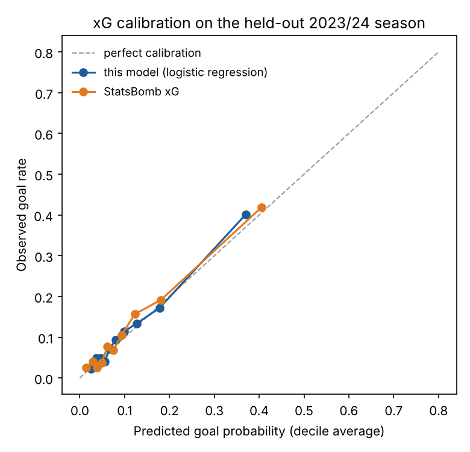
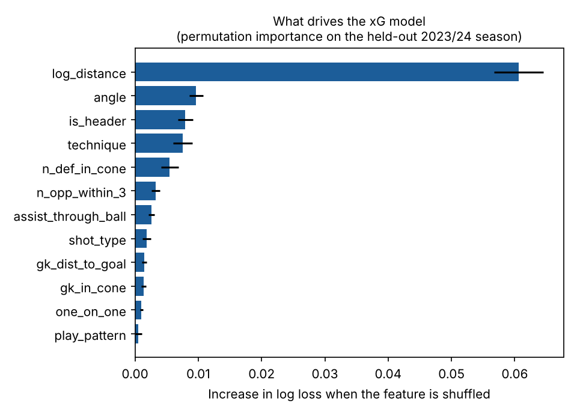
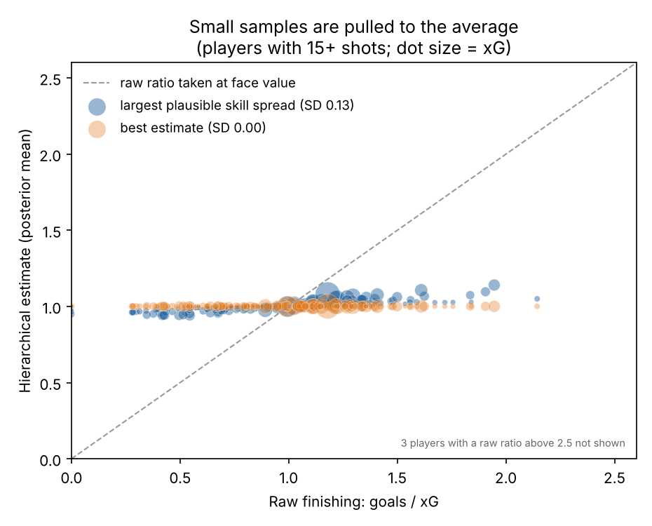
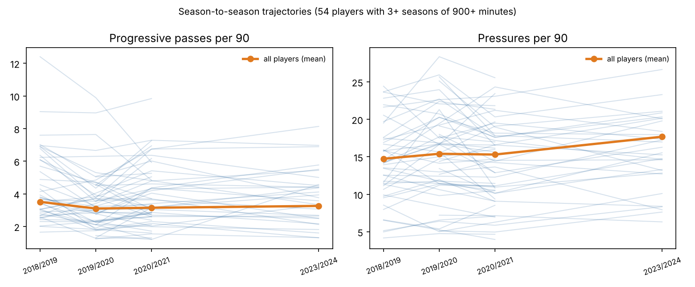
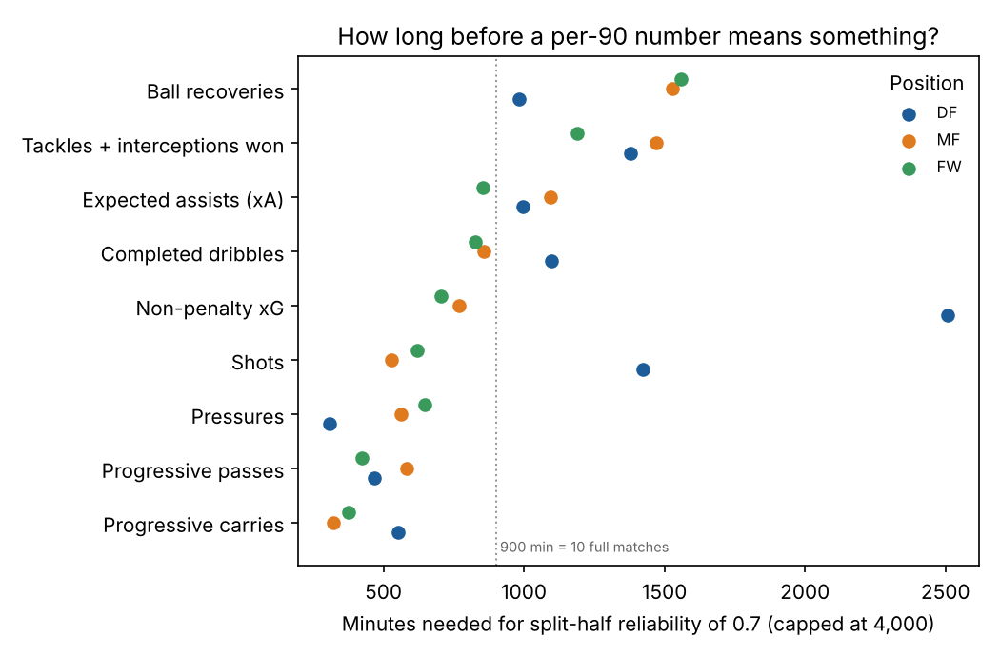
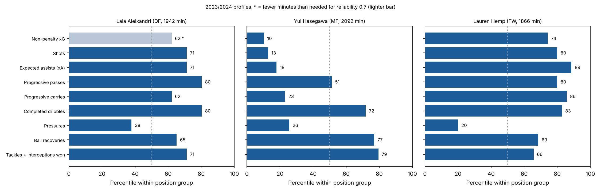

# Results

Generated by `python -m player_development analyse` from the CSV files in this folder. Data: StatsBomb open data, FA Women's Super League 2018/19, 2019/20, 2020/21 and 2023/24.

## 1. Data quality

| check | passed | detail |
| --- | --- | --- |
| every match has events and lineups | True | 457 matches, 0 missing files |
| goals in events match final scores | True | 0 of 457 matches differ (own goals included) |
| team minutes equal 11 players x match length | True | ratio range 10.03-11.00; values below 11 come from red cards |
| player minutes within 0-130 | True | max 107.9 minutes |
| one row per player per match | True | 12919 player-match rows |
| shot locations inside the pitch (0.5-yard tolerance) | True | 0 outside |
| StatsBomb xG between 0 and 1 | True | 11816 shots |
| goal flag matches shot outcome | True | 1378 goals |
| shots have a freeze frame (>= 98%) | True | 99.2% of shots |
| every shooter has minutes in that match | True | 0 shots without minutes |
| main position known (< 0.5% unknown) | True | 19 player-match rows without a position (late substitutes with no events) |
| event players found in minutes table | True | 0 players with events but no minutes |

## 2. Expected goals (xG)

Selected model: **logistic regression** (lowest cross-validated log loss). Folds are grouped by match so shots from the same game never sit in both training and test data. The 2023/24 season was used once, at the end.

| model | evaluation | shots | goals | xg_total | log_loss | brier | roc_auc | calibration_error |
| --- | --- | --- | --- | --- | --- | --- | --- | --- |
| logistic_regression | 5-fold CV by match, 2018/19-2020/21 | 8205 | 898 | 892.914 | 0.295 | 0.085 | 0.774 | 0.006 |
| gradient_boosting | 5-fold CV by match, 2018/19-2020/21 | 8205 | 898 | 879.023 | 0.297 | 0.085 | 0.770 | 0.017 |
| statsbomb_xg (benchmark) | 5-fold CV by match, 2018/19-2020/21 | 8205 | 898 | 854.930 | 0.293 | 0.083 | 0.774 | 0.011 |
| logistic_regression | held-out season 2023/24 | 3506 | 402 | 380.296 | 0.308 | 0.089 | 0.750 | 0.011 |
| gradient_boosting | held-out season 2023/24 | 3506 | 402 | 386.440 | 0.312 | 0.089 | 0.747 | 0.018 |
| statsbomb_xg (benchmark) | held-out season 2023/24 | 3506 | 402 | 375.089 | 0.300 | 0.086 | 0.775 | 0.014 |

## 3. Finishing skill (hierarchical Gamma-Poisson model)

League-average finishing multiplier mu = 1.001. Best-estimate spread of finishing skill between players: SD 0.001; the largest spread the data cannot rule out (95% profile likelihood): SD 0.127.

Season-to-season correlation of raw finishing (goals minus xG per shot, players with 20+ shots in both seasons, n = 64): r = -0.04 (p = 0.74).

Predicting next season's goals from next season's xG and this season's finishing:

| from_season | to_season | players | method | mae_goals | rmse_goals |
| --- | --- | --- | --- | --- | --- |
| 2018/2019 | 2019/2020 | 127 | league average | 0.803 | 1.238 |
| 2018/2019 | 2019/2020 | 127 | raw goals / xG | 0.919 | 1.684 |
| 2018/2019 | 2019/2020 | 127 | hierarchical (shrunk) | 0.803 | 1.238 |
| 2019/2020 | 2020/2021 | 128 | league average | 0.889 | 1.381 |
| 2019/2020 | 2020/2021 | 128 | raw goals / xG | 1.632 | 3.236 |
| 2019/2020 | 2020/2021 | 128 | hierarchical (shrunk) | 0.889 | 1.381 |
| 2020/2021 | 2023/2024 | 99 | league average | 0.754 | 1.123 |
| 2020/2021 | 2023/2024 | 99 | raw goals / xG | 1.396 | 2.363 |
| 2020/2021 | 2023/2024 | 99 | hierarchical (shrunk) | 0.754 | 1.123 |

Highest-volume shooters (all four seasons). `low`/`high` is the 80% interval; `_wide` columns use the largest plausible skill spread:

| player_name | team | shots | goals | xg | raw_ratio | shrunk_ratio | low | high | shrunk_ratio_wide | low_wide | high_wide |
| --- | --- | --- | --- | --- | --- | --- | --- | --- | --- | --- | --- |
| Vivianne Miedema | Arsenal WFC | 296 | 57 | 48.33 | 1.18 | 1.00 | 1.00 | 1.00 | 1.08 | 0.95 | 1.21 |
| Bethany England | Tottenham Hotspur Women | 196 | 34 | 34.19 | 0.99 | 1.00 | 1.00 | 1.00 | 1.00 | 0.87 | 1.13 |
| Sam Kerr | Chelsea FCW | 124 | 26 | 25.39 | 1.02 | 1.00 | 1.00 | 1.00 | 1.01 | 0.87 | 1.15 |
| Chloe Kelly | Manchester City WFC | 188 | 22 | 19.81 | 1.11 | 1.00 | 1.00 | 1.00 | 1.03 | 0.89 | 1.17 |
| Ellen White | Manchester City WFC | 118 | 22 | 19.74 | 1.11 | 1.00 | 1.00 | 1.00 | 1.03 | 0.89 | 1.17 |
| Lauren Hemp | Manchester City WFC | 137 | 24 | 19.62 | 1.22 | 1.00 | 1.00 | 1.00 | 1.05 | 0.91 | 1.20 |
| Nikita Parris | Manchester United W | 107 | 23 | 18.93 | 1.22 | 1.00 | 1.00 | 1.00 | 1.05 | 0.91 | 1.20 |
| Francesca Kirby | Chelsea FCW | 130 | 24 | 18.52 | 1.30 | 1.00 | 1.00 | 1.00 | 1.07 | 0.92 | 1.22 |
| Georgia Stanway | Manchester City WFC | 157 | 20 | 17.38 | 1.15 | 1.00 | 1.00 | 1.00 | 1.03 | 0.89 | 1.18 |
| Bethany Mead | Arsenal WFC | 149 | 22 | 17.33 | 1.27 | 1.00 | 1.00 | 1.00 | 1.06 | 0.91 | 1.21 |
| Martha Thomas | Tottenham Hotspur Women | 122 | 15 | 16.82 | 0.89 | 1.00 | 1.00 | 1.00 | 0.98 | 0.84 | 1.12 |
| Danielle van de Donk | Arsenal WFC | 74 | 17 | 15.32 | 1.11 | 1.00 | 1.00 | 1.00 | 1.02 | 0.88 | 1.17 |
| Erin Cuthbert | Chelsea FCW | 153 | 14 | 14.30 | 0.98 | 1.00 | 1.00 | 1.00 | 1.00 | 0.85 | 1.15 |
| Jordan Nobbs | Aston Villa W | 119 | 20 | 14.20 | 1.41 | 1.00 | 1.00 | 1.00 | 1.08 | 0.93 | 1.23 |
| Alessia Russo | Arsenal WFC | 92 | 14 | 13.38 | 1.05 | 1.00 | 1.00 | 1.00 | 1.01 | 0.86 | 1.16 |

## 4. Development trajectories (longitudinal mixed-effects models)

Outfield player-seasons with 900+ minutes: 487 rows, 303 players, 117 with two or more seasons. Model: rate ~ years + position + (1 + years | player), REML.

| Metric (per 90) | Mean | Change per year (95% CI) | ICC (player share) | SD of player slopes | p (slopes differ) |
| --- | --- | --- | --- | --- | --- |
| Non-penalty xG | 0.128 | -0.002 (-0.006 to 0.003) | 0.632 | 0.012 | 0.001 |
| Shots | 1.225 | -0.021 (-0.050 to 0.008) | 0.637 | 0.078 | 0.074 |
| Expected assists (xA) | 0.093 | +0.001 (-0.003 to 0.004) | 0.466 | 0.001 | 0.584 |
| Progressive passes | 3.252 | -0.013 (-0.073 to 0.047) | 0.614 | 0.266 | 0.001 |
| Progressive carries | 1.543 | -0.027 (-0.072 to 0.018) | 0.672 | 0.238 | 0.000 |
| Completed dribbles | 0.973 | -0.085 (-0.106 to -0.063) | 0.704 | 0.027 | 0.265 |
| Pressures | 15.876 | +0.490 (0.317 to 0.664) | 0.678 | 0.458 | 0.260 |
| Ball recoveries | 4.766 | -0.055 (-0.103 to -0.006) | 0.455 | 0.159 | 0.020 |
| Tackles + interceptions won | 1.853 | -0.023 (-0.051 to 0.005) | 0.525 | 0.008 | 0.725 |

## 5. Minutes needed before a metric is reliable

Minutes of play needed for a split-half reliability of 0.7 (200 random splits, within position group):

| Metric (per 90) | DF | MF | FW |
| --- | --- | --- | --- |
| Non-penalty xG | 2508 | 768 | 704 |
| Shots | 1424 | 529 | 620 |
| Expected assists (xA) | 997 | 1095 | 853 |
| Progressive passes | 467 | 584 | 424 |
| Progressive carries | 554 | 322 | 377 |
| Completed dribbles | 1099 | 857 | 827 |
| Pressures | 307 | 562 | 647 |
| Ball recoveries | 983 | 1527 | 1557 |
| Tackles + interceptions won | 1380 | 1469 | 1188 |

## 6. Example profiles

Percentiles within position group for the 2023/24 season, with metrics below the reliability threshold greyed out. Players: the highest-minute defender, midfielder and forward of Manchester City WFC.

